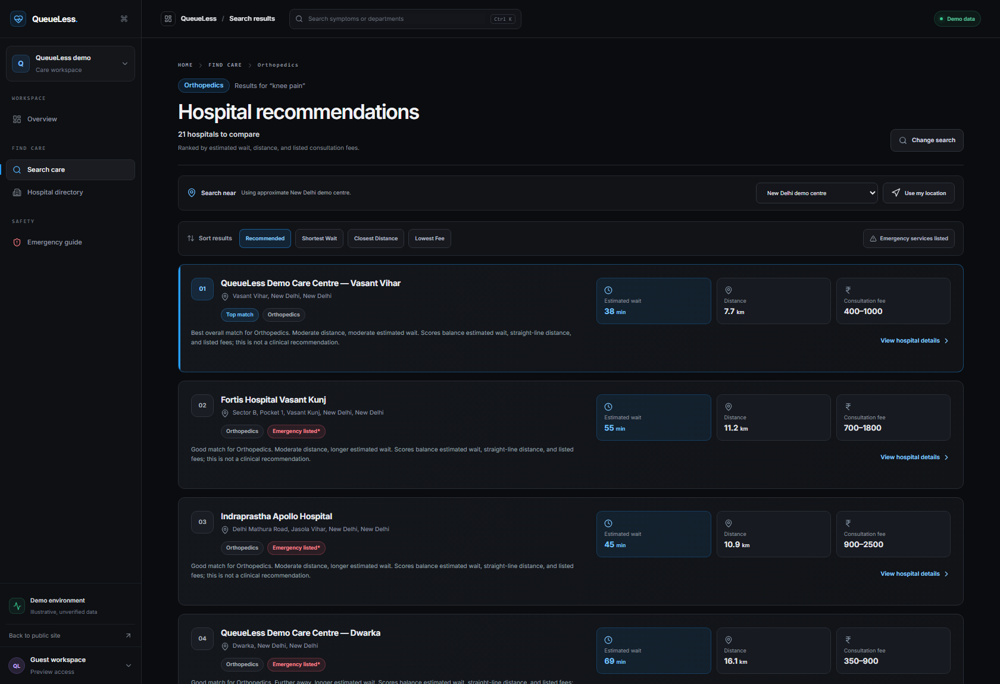

# QueueLess

QueueLess is a healthcare-navigation **academic MVP**. It helps people explore a demonstration hospital directory, route a symptom phrase to a department, compare nearby facilities, and inspect illustrative queue forecasts.

> **Important:** QueueLess is not a medical service. It does not diagnose, triage, book appointments, or report live availability. Hospital, clinician, fee, phone, and emergency-service records in this prototype are unverified demonstration data. Queue estimates and rankings are synthetic. For a medical emergency in India, call **108** or **112**; do not wait for this app.

## Run on Windows

Requirements: **Python 3.11+**, **Node.js 20.19+ or 22.12+**, and npm.

Open PowerShell in the project folder and run:

```powershell
.\scripts\run.ps1
```

If PowerShell blocks local scripts, allow scripts for this terminal only, then run it:

```powershell
Set-ExecutionPolicy -Scope Process -ExecutionPolicy Bypass
.\scripts\run.ps1
```

The launcher creates `backend\venv` if needed, installs missing dependencies, prepares the local SQLite demonstration database, and starts the API and frontend together. It checks that both services are ready and stops them when you press **Ctrl+C**. It does not require PostgreSQL or separate terminal windows. The local database is kept at `backend\queueless.db` and ignored by Git.

Open:

- Web app: <http://127.0.0.1:5173>
- Interactive API docs: <http://127.0.0.1:8000/docs>
- API health: <http://127.0.0.1:8000/api/health>

The launcher owns ports **8000** and **5173**. If it reports that a port is already in use, stop the other service using that port and rerun the command.

## Screenshots

The screenshots below show the desktop-first care search and hospital comparison experience. All facilities and estimates shown are demonstration data.

### Find care


### Search results



### Optional: run services separately

```powershell
Set-Location backend
$env:DATABASE_URL = "sqlite:///./queueless.db"
.\venv\Scripts\python.exe -m uvicorn app.main:app --reload --port 8000
```

In another terminal:

```powershell
Set-Location frontend
npm run dev
```

The launcher is preferred because it also checks requirements and prepares the demo data.

## Sign in and demo account

Create an account with your name, email, and a password of at least eight characters, or choose **Continue with demo account** to enter as **QueueLess Demo** without a password. Signed-in names appear in the workspace and public navigation. Passwords are stored as salted scrypt hashes; browser sessions are kept in session storage and expire after seven days. The demo account is shared and is intended only for exploring this prototype.

## Main user journey

1. Search for a supported symptom or browse the hospital directory.
2. Select an approximate search area or explicitly grant device-location permission.
3. Compare nearby listed facilities by estimated queue, straight-line distance, and fee range.
4. Open a hospital profile to review listed departments and an hourly demonstration forecast.
5. Use the emergency page for call guidance; emergency directory flags are not independently verified.

The included demo seed provides 28 directory entries: existing example profiles plus 12 explicitly named synthetic QueueLess care centres. Queue projections use a transparent workload heuristic:

```text
estimated wait = 5-minute intake buffer + ceil(60 × queue size / assumed hourly service capacity)
```

The hourly queue starts from an illustrative daily demand curve, adjusted by a stable hospital factor and a department demand factor. Service capacity is also a synthetic per-department assumption. Neither the directory nor this calculation reflects verified staffing, historical hospital feeds, or live queue conditions.

The current symptom rules are transparent keyword routing—not a clinical model. Unknown phrases fall back to General Medicine. A symptom alone cannot establish a diagnosis or whether care is urgent; call emergency services when needed.

## Validation commands

From the project root:

```powershell
npm --prefix frontend run build
npm --prefix frontend run lint
Set-Location backend
.\venv\Scripts\python.exe -m pip install -r requirements-dev.txt
.\venv\Scripts\python.exe -m pytest tests -v
```

## Project structure and maintenance

```text
backend/       FastAPI API, SQLAlchemy models, idempotent demo seeder, and tests
frontend/      React + TypeScript application and workspace styles
docs/          Architecture, design, decisions, testing notes, and screenshots
scripts/       Windows PowerShell launcher for the complete local demo
```

For routine changes, install frontend dependencies from the lockfile with `npm --prefix frontend ci`, run the frontend build and lint checks, and run backend tests from `backend` using the virtual environment commands above. The demo seeder is safe to rerun: it adds missing sample records without deleting existing data. The launcher selects the local SQLite database automatically.

Keep local configuration (`backend/.env`), the generated database (`backend/queueless.db`), virtual environments, and dependency/build output out of commits. Only update `.env.example` with placeholder configuration—never credentials. Review the [architecture](docs/ARCHITECTURE.md), [design system](docs/DESIGN_SYSTEM.md), and [testing guide](docs/TESTING.md) when changing the corresponding project behavior.

## Stack and design

- **Frontend:** React 19, TypeScript, Vite, Tailwind CSS 4, React Router 7, Lucide
- **API:** FastAPI, Pydantic, SQLAlchemy
- **Default database:** SQLite for a reproducible local demo; `DATABASE_URL` can point at another SQLAlchemy-supported database
- **Design:** desktop-first dark care workspace, open dashboard and directory layouts, accessible controls, and clear error/empty states

## Scope and next production steps

The MVP includes the landing page, symptom search, hospital directory with filters, ranked results, hospital profiles, department selection, hourly wait visualization, location consent, emergency calling guidance, and basic account sign-in. It is not production identity management and must not be used to store health information.

This repository is suitable for an academic demonstration, **not deployment for patient care**. Production use would require, at minimum, verified provider data and update agreements, real queue/availability integrations, clinically reviewed safety flows, location/privacy controls, authentication and authorization, audit/security review, database migrations, monitoring, accessibility testing, and end-to-end testing. Do not enter personal health information.
