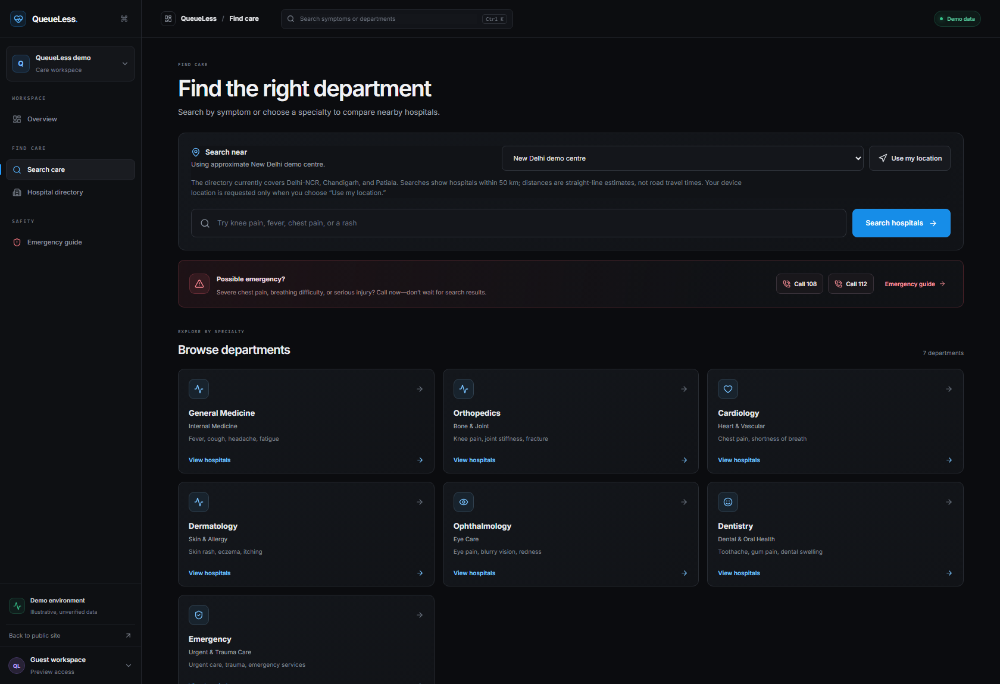

# QueueLess

QueueLess is a healthcare navigation demo for finding hospital departments, comparing nearby listings, and reviewing estimated queue times. It includes a React web app and a FastAPI service backed by SQLite.

> **Demo data:** Hospital details, consultation fees, ratings, availability, and queue estimates are illustrative. QueueLess is not connected to hospital scheduling systems and is not medical advice.

## Screenshots

### Find care



### Search results


## Features

- Search by symptom or department and review matching hospital listings.
- Compare results by estimated wait, distance, and listed consultation fee.
- View department, facility, and queue information for each hospital.
- Review deterministic hourly wait estimates and suggested visit windows.
- Create an account, sign in, or use the demo sign-in option.
- Use the appointment form to create a confirmation token and view it on the patient dashboard.
- Browse the directory across Delhi-NCR, Chandigarh, and Patiala.

## How it works

The browser app is built with React and TypeScript. It sends directory, search, queue, and account requests to the FastAPI backend. The backend reads the local SQLite database, which is populated with sample records by the setup script.

```text
React app (Vite)  →  FastAPI (/api)  →  SQLAlchemy  →  SQLite
```

Appointment confirmations are currently stored in the browser rather than submitted to a hospital.

## Technology

- **Frontend:** React 19, TypeScript, Vite 8, Tailwind CSS 4, React Router 7
- **Backend:** Python 3.11+, FastAPI, Pydantic, SQLAlchemy, Uvicorn
- **Database:** SQLite by default
- **Tests and linting:** pytest, HTTPX, TypeScript, Oxlint

## Requirements

The Windows launcher requires:

- PowerShell
- Python 3.11 or newer
- Node.js 20.19+ or 22.12+ (with npm)

## Run locally on Windows

Clone the repository, open PowerShell in its root folder, and run:

```powershell
git clone https://github.com/lakshysingh156/QueueLess.git
cd QueueLess
.\scripts\run.ps1
```

The launcher creates the Python environment if needed, installs missing dependencies, prepares the sample database, and starts the web app and API. Press **Ctrl+C** in that terminal to stop both services. Ports `8000` and `5173` must be available.

If PowerShell blocks the script, allow scripts for the current process and run it again:

```powershell
Set-ExecutionPolicy -Scope Process -ExecutionPolicy Bypass
.\scripts\run.ps1
```

When the services are ready:

- Web app: <http://127.0.0.1:5173>
- API documentation: <http://127.0.0.1:8000/docs>
- API health check: <http://127.0.0.1:8000/api/health>

## Run services manually

Open two PowerShell terminals from the repository root.

### Backend

```powershell
cd backend
python -m venv venv
.\venv\Scripts\Activate.ps1
python -m pip install -r requirements.txt
python seed.py
python -m uvicorn app.main:app --reload --host 127.0.0.1 --port 8000
```

### Frontend

```powershell
cd frontend
npm ci
npm run dev -- --host 127.0.0.1
```

## Accounts and saved appointments

Use the sign-in page to create an account or choose the demo sign-in option. Account authentication is handled by the backend.

Appointment tokens are stored in browser `localStorage` on the device where they were created. They are not synchronized between devices or submitted to a hospital, and no SMS notifications are sent.

## Data and safety notes

- Queue and wait-time values are generated from sample data; they are not live hospital feeds.
- Hospital details, fees, ratings, and availability may be outdated or inaccurate. Confirm them directly with the hospital.
- Browser location is optional and is requested only when **Use my location** is selected.
- For a medical emergency in India, call **108** or **112**. Do not wait for app results.

## Tests and checks

### Backend tests

```powershell
cd backend
python -m pip install -r requirements-dev.txt
python -m pytest -q
```

### Frontend build and lint

```powershell
cd frontend
npm ci
npm run build
npm run lint
```

## Project layout

```text
backend/
  app/                 API routes, database models, and search/queue logic
  tests/               Backend tests
  seed.py              Sample database setup
frontend/
  src/components/      Shared interface components
  src/pages/           App pages
scripts/
  run.ps1              Windows setup and development launcher
docs/screenshots/      README screenshots
```
